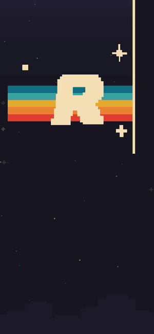
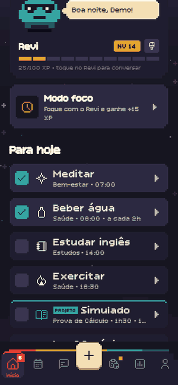
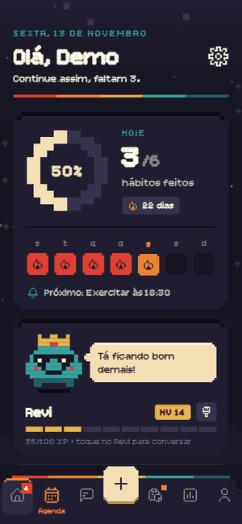
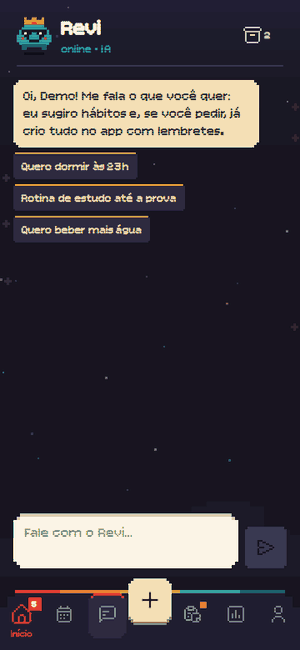
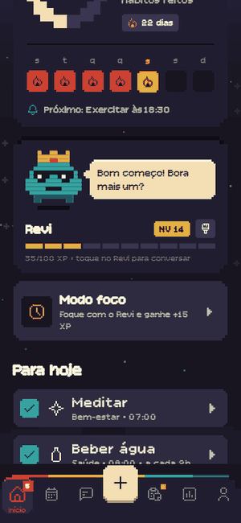
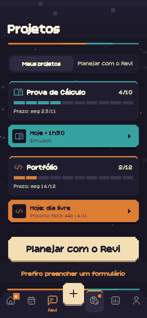
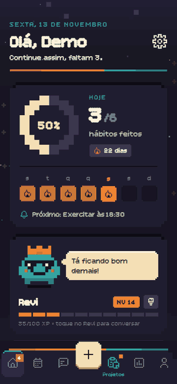
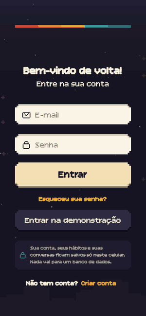

## Aluno
• Nome: Tulio Medeiros Borges

• RGM: 42288231

• Unifran - Análise e Desenvolvimento de Sistemas - Euller Da Silva Ferreira

# Rever

**Pequenos hábitos, grandes mudanças.** Rever é um app de hábitos e rotina em pixel art, feito com React Native e Expo. Você monta a sua rotina, recebe lembretes na hora certa e cuida do **Revi**, um mascote que reage ao seu dia, ganha XP e sobe de nível com você. Ele também conversa com você por IA e ajuda a montar rotinas e planejar projetos.

<p align="center">
  
  
  
</p>

## Entre na conta de demonstração

A conta de demonstração já vem cheia de dados para mostrar tudo o que o app faz:

| E-mail | Senha |
|---|---|
| `demo@rever.app` | `rever123` |

Também dá para tocar em **Entrar na demonstração** na tela de login.

O que você encontra nela:
- **Hábitos:** 7 hábitos, um deles com lembrete a cada 2 horas.
- **Histórico e Revi:** 3 semanas de histórico, com sequência de 22 dias. O Revi está no nível 14, com coroa e óculos.
- **Conquistas:** 14 de 18 abertas. A **Centenário** está em 99/100, então é só marcar um hábito para ver a conquista abrir na hora.
- **Projetos:** 2 projetos com cronograma, tarefas por dia e uma sessão marcada para **hoje**.
- **Conversas:** conversas com o Revi, inclusive no histórico.
- **Foco:** sessões de foco já registradas.
- **Atraso de exemplo:** um hábito atrasado, para mostrar o aviso e o popup do Revi triste. Ele aparece quando você entra depois da 1h da manhã.

> A demonstração é **recriada a cada login**, com as datas de hoje. O que você mudar nela some quando entrar de novo. Para usar o app de verdade, crie uma conta: ela começa vazia.

## O que o app faz

### Hábitos, lembretes e prazos
- Crie hábitos com ícone, categoria, dias da semana e horário. O lembrete pode **repetir ao longo do dia** (por exemplo, água a cada 2h, das 8h às 20h).
- **"Posso começar até"**: você escolhe quanto tempo pode atrasar para começar (na hora, 15 min, 30 min, 1 h ou 2 h).
- **Prazo acabando**: 10 minutos antes do limite chega uma notificação com os botões **Começar agora** e **Mais tarde**. A Início também mostra o aviso.
- **Passou do horário**: chega outra notificação. Ao tocar nela, o app abre um **popup do Revi triste** pedindo para você **confirmar que não vai fazer hoje** ou **mudar o horário** (só para hoje).
- Na Início, a lista **Para hoje** junta hábitos e sessões de projeto em ordem de horário, e os **Próximos dias** mostram o que vem pela frente.
- Só dá para marcar o **dia de hoje**: dia que já passou fica como está.

### O Revi
- Mascote em pixel art que **reage ao seu dia**: dorme, fica neutro, feliz, radiante ou triste. Cada humor tem a sua voz.
- Ganha **XP** a cada hábito, dia perfeito e sessão de foco, e **sobe de nível**.
- **Personalização**: nome, 9 cores (incluindo um Revi arco-íris), 12 acessórios (coroa, mago, gorro, auréola…) e 6 rostos (nerd, pirata, bigode, monóculo…). Muitas opções só abrem em níveis mais altos.
- **Balão de fala** com frases sobre o seu dia: "Às 19:00 tem Prova de Cálculo. Não esquece!".

<p align="center">
  
  
</p>

### Conversa com o Revi (IA)
- Chat com o Revi usando o **Gemini** (Google), que é gratuito.
- Ele **entende o pedido**. Se você escreve "quero dormir às 23h", ele já sugere hábitos com os horários calculados, e você adiciona com um toque.
- Se você pede ("cria uma rotina de estudo até a prova do dia 23"), ele **cria tudo sozinho no app**, com lembretes. Um cartão mostra o que foi criado, e dá para **desfazer**.
- Sempre mostra **respostas rápidas** embaixo do balão para continuar a conversa.
- **Histórico**: ao sair do chat, a conversa vai para o histórico. Dá para reler e continuar de onde parou.
- Quando o limite gratuito do Gemini acaba, o Revi **avisa no próprio chat**.

### Projetos
- Aba **Planejar com o Revi**: você conta a ideia, e ele pergunta uma coisa por vez (prazo, dias, tempo por dia) com opções prontas.
- Depois mostra o **plano dia a dia**: o que fazer em cada dia e quanto tempo dedicar.
- As sessões vão para os **dias mais leves da sua semana**, considerando os hábitos que você já tem.
- Cada projeto tem um **botão "Hoje"** com a cor dele, mostrando quanto tempo dedicar hoje e as **tarefas do dia** para ir marcando.
- Também dá para criar o projeto por formulário. Sem IA, o app monta o plano sozinho.

<p align="center">
  
  
  
</p>

### Modo foco, progresso e conquistas
- **Modo foco**: timer com o Revi do lado. Ao terminar, marca o hábito (ou a sessão do projeto) e dá XP extra. A tela não apaga durante a sessão.
- **Progresso**: gráfico por semana, mês e ano, sequência atual, recorde e progresso por hábito.
- **18 conquistas**, com aviso animado e som quando abrem.

### Experiência
- **Visual**: pixel art com as cores da logo, fonte pixel e céu estrelado animado.
- **Navegação**: barra de baixo fixa, com os elementos de cada tela entrando com animação de mola.
- **Toque**: vibração ao apertar e ao soltar os botões, e sons próprios em 8 bits (dá para desligar no Perfil).

### Contas e privacidade
- **Contas locais**: tudo fica **só no celular**, sem servidor nem banco de dados. Cada conta tem os seus próprios dados.
- **Senha**: é guardada apenas como **hash SHA-256 com sal** (`expo-crypto`).
- **Ao sair da conta**: os lembretes dela são cancelados.
- **IA**: o texto enviado para o Revi passa pelo Gemini para ser respondido. No plano gratuito, o Google pode usar esse texto para melhorar os produtos dele.

## Como executar

```bash
npm install
npx expo start
```

Abra no **Expo Go** (Android ou iPhone) lendo o QR code. As notificações locais, os sons e a vibração funcionam no Expo Go.

### IA do Revi (opcional, grátis)
1. Crie uma chave gratuita em https://aistudio.google.com/apikey.
2. Cole a chave no app (aba **Revi**) **ou** crie um arquivo `.env.local` a partir do `.env.example`:
   ```
   EXPO_PUBLIC_GEMINI_API_KEY=sua-chave
   ```
3. Rode `npx expo start -c` para o Expo ler o arquivo.

O `.env.local` está no `.gitignore`. **Nunca coloque a chave em arquivos versionados.** Sem chave, o app funciona normalmente: só a conversa com a IA fica desligada, e os projetos são planejados pelo próprio app.

## Telas
- **Splash** e **Onboarding**: abertura com a logo animada e três passos de apresentação.
- **Login**, **Cadastro** e **Esqueceu a senha**: contas locais. Sem servidor não existe e-mail de recuperação, então a tela permite apagar a conta do celular e criar outra.
- **Abas**: Início, Agenda, Revi (chat), Projetos, Progresso e Perfil. Na barra fica também o botão **+** para criar hábito.
- **Criar Hábito** e **Editar Hábito**: formulário do hábito.
- **Modo foco**, **Personalizar Revi**, **Editar perfil** e **Conquistas**.
- **Novo projeto** e **Detalhe do projeto**.
- **Histórico de conversas** e **Conversa antiga**.

## Tecnologias
- **Base**: Expo SDK 58, React Native 0.88 e React 19.
- **Navegação**: React Navigation 7, com pilha nativa e abas com barra personalizada.
- **Expo**: `expo-notifications` (notificações locais), `expo-audio` (sons), `expo-haptics` (vibração), `expo-crypto` (senha), `expo-keep-awake` (modo foco) e `expo-font`.
- **Armazenamento**: AsyncStorage.
- **IA**: Gemini, pela API REST do Google AI Studio.
- **Visual**: `react-native-svg` e [pixelarticons](https://pixelarticons.com) (MIT) para os ícones. A fonte é a [Bitcount](https://github.com/petrvanblokland/TYPETR-Bitcount) (OFL), com a altura das letras ajustada para os acentos não cortarem no Android; a licença está em `assets/fontes/OFL.txt`.
- **Sons**: compostos em código para o app.

## Estrutura
```
App.js              navegação (entrada × app logado) e abas
screens/            uma tela por arquivo
components/         componentes reutilizáveis (Botao, ItemHabito, ChatRevi, MascoteRevi, BarraInferior…)
contexto/           ContaContexto (contas locais) e HabitosContexto (dados de cada conta)
utils/              estatísticas, lembretes, prazos, IA (gemini, reviIA), sons, vibração, datas
data/               conquistas, opções, personalização do Revi e a conta de demonstração
assets/             imagens, logo em camadas, fontes e sons
docs/gifs/          GIFs deste README
```

Para entender o código por dentro (navegação, contextos, `useState`, `useEffect`, lembretes e IA), veja a **[Documentação](docs/DOCUMENTACAO.md)**.

## Requisitos do trabalho

| Requisito | Onde está |
|---|---|
| Componentização | `components/`: 38 componentes, como `Botao`, `ItemHabito`, `ChatRevi`, `MascoteRevi`, `BarraInferior` e `FormularioHabito` |
| Props e callbacks | `aoPressionar` em `Botao`, `ItemHabito` e `LinkTexto`; `aoMarcar` em `ItemHabito`; `aoSalvar` em `FormularioHabito`; `aoVoltar` em `CabecalhoTela`; `aoPersonalizar` em `CartaoRevi` |
| useState | Formulários (`FormularioHabito`, `EditarPerfil`, `Login`, `Cadastro`), dia escolhido (`Agenda`), período (`Progresso`) e todos os dados em `contexto/HabitosContexto.js` |
| useEffect com limpeza | Relógio com `clearInterval` (`Inicio`); animações paradas ao sair (`MascoteRevi`, `FundoPixel`); `clearTimeout` (`AvisoConquista`); ouvinte de notificações removido (`RespostaNotificacoes`); carregar e salvar dados (`HabitosContexto`) |
| Navegação (3+ telas) e `route.params` | 22 telas. `EditarHabito` recebe `{ id }`, `ProjetoDetalhe` recebe `{ id }`, `ConversaAntiga` recebe `{ canal, id }`, `Foco` recebe `{ habitoId }` ou `{ sessao }`, e `Onboarding` recebe `{ passo }` |
| Título do header em `options` | Tela **Conquistas**, em `App.js` |
| JavaScript moderno | `const` e `let`, arrow functions, desestruturação, `===` e nenhum `console.log` |
| StyleSheet | `StyleSheet.create` em todos os componentes e telas |
| Feedback ao usuário | Validação de formulários, vibração, sons, avisos, popups e mensagens de erro |

## Vídeo de demonstração
[▶️ Assistir ao vídeo de demonstração](docs/reverapp.mp4) (25 s)
