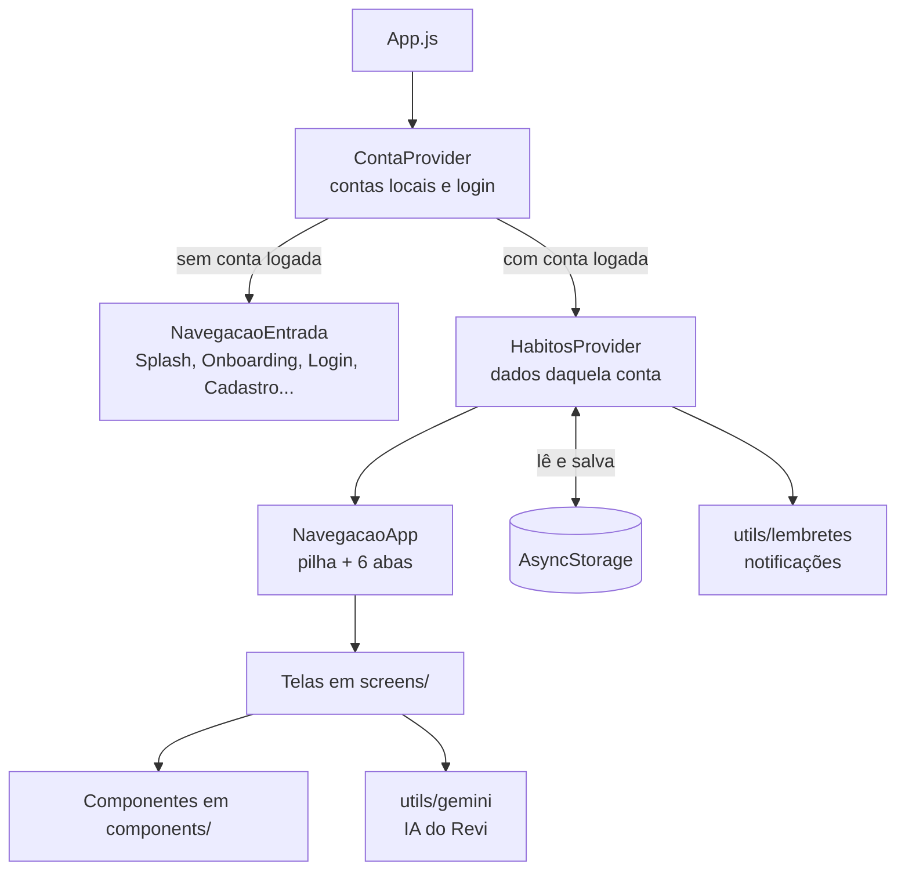
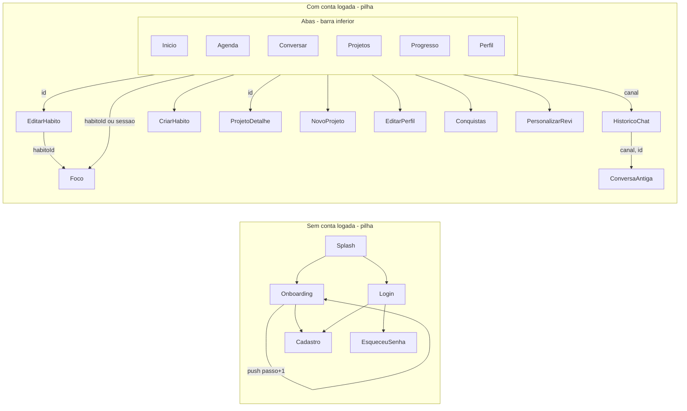
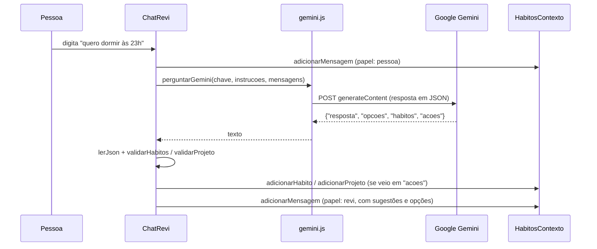

# Documentação do Rever

Esta documentação explica **como o app funciona por dentro**: como as telas se ligam, onde ficam os dados, como o estado muda e para que serve cada `useEffect`. Para saber **o que** o app faz e como rodar, veja o [README](../README.md).

Sumário:

1. [Visão geral](#1-visão-geral)
2. [Estrutura de pastas](#2-estrutura-de-pastas)
3. [Como o app abre](#3-como-o-app-abre-appjs)
4. [Navegação](#4-navegação)
5. [Dados e estado: os dois contextos](#5-dados-e-estado-os-dois-contextos)
6. [useState na prática](#6-usestate-na-prática)
7. [useEffect na prática](#7-useeffect-na-prática)
8. [Componentes e props](#8-componentes-e-props)
9. [Lembretes e notificações](#9-lembretes-e-notificações)
10. [IA do Revi (Gemini)](#10-ia-do-revi-gemini)
11. [XP, nível, sequência e conquistas](#11-xp-nível-sequência-e-conquistas)
12. [Visual, sons e vibração](#12-visual-sons-e-vibração)
13. [Caminho de uma ação, do toque à tela](#13-caminho-de-uma-ação-do-toque-à-tela)
14. [Perguntas frequentes](#14-perguntas-frequentes)

---

## 1. Visão geral

O Rever é um app **Expo / React Native** sem servidor. Tudo fica salvo no próprio celular com o **AsyncStorage**.



A ideia principal é esta: **as telas não guardam os dados do app**. Elas leem e mudam os dados por funções de um **contexto** (`useHabitos()` ou `useConta()`). O contexto guarda tudo num estado, salva no AsyncStorage e avisa todas as telas quando algo muda.

---

## 2. Estrutura de pastas

| Pasta | O que tem | Exemplos |
|---|---|---|
| `App.js` | Ponto de entrada: fontes, contextos e navegação | |
| `screens/` | Uma tela por arquivo (22 telas) | `Inicio.js`, `EditarHabito.js`, `Foco.js` |
| `components/` | Peças reutilizáveis da interface (38 componentes) | `Botao.js`, `ItemHabito.js`, `CampoTexto.js` |
| `contexto/` | Estado global do app | `ContaContexto.js`, `HabitosContexto.js` |
| `utils/` | Funções puras e serviços (datas, XP, lembretes, IA, sons) | `estatisticas.js`, `lembretes.js`, `gemini.js` |
| `data/` | Dados fixos: opções, conquistas, visual do Revi e a conta de demonstração | `conquistas.js`, `demo.js` |
| `services/` | Cliente HTTP com axios (`api.js`) | |
| `styles/` | Cores e fontes do tema | `tema.js` |
| `assets/` | Imagens, fontes e sons | |

Regra usada no projeto: **tela** monta a página e decide a navegação, **componente** desenha um pedaço e avisa por callback, **contexto** guarda e muda os dados, e **utils** calcula sem desenhar nada.

---

## 3. Como o app abre (`App.js`)

1. `SplashScreen.preventAutoHideAsync()` segura a tela de abertura nativa.
2. `useFonts` carrega a fonte pixel (Bitcount).
3. `ContaProvider` lê do AsyncStorage as contas e a sessão salva.
4. O componente `Raiz` decide o que mostrar:
   - fontes ou contas ainda carregando: mostra nada (`return null`);
   - **sem conta logada**: `<NavegacaoEntrada />`;
   - **com conta logada**: `<HabitosProvider key={conta.id}>` + `<NavegacaoApp />`.
5. Quando os dados carregam, `useEsconderSplash` esconde a splash.

Esse é o **padrão de autenticação do React Navigation**: o app não navega de "Login" para "Início". Quando `entrar()` grava a sessão, a `conta` muda no contexto, e o `Raiz` troca sozinho de uma navegação para a outra.

O `key={conta.id}` no `HabitosProvider` serve para **recriar todo o estado do zero** ao trocar de conta. Assim os dados de uma pessoa nunca aparecem para outra.

---

## 4. Navegação

Bibliotecas: `@react-navigation/native`, `@react-navigation/native-stack` (pilha) e `@react-navigation/bottom-tabs` (abas). O `NavigationContainer` só aparece no `App.js`.

### Mapa das telas



### Parâmetros entre telas (`route.params`)

| Quem chama | Tela de destino | Parâmetro | Como lê |
|---|---|---|---|
| `Inicio` → toque num hábito | `EditarHabito` | `{ id }` | `const { id } = route.params;` |
| `EditarHabito`, `Inicio`, notificação | `Foco` | `{ habitoId }` ou `{ sessao }` | `route.params?.habitoId` |
| `Projetos`, `Inicio`, chat | `ProjetoDetalhe` | `{ id }` | `const { id } = route.params;` |
| `ChatRevi` | `HistoricoChat` | `{ canal }` | `const { canal } = route.params;` |
| `HistoricoChat` | `ConversaAntiga` | `{ canal, id }` | `const { canal, id } = route.params;` |
| `Splash` / `Onboarding` | `Onboarding` | `{ passo }` | `route.params?.passo ?? 0` |
| Notificação | `Inicio` (dentro de `Abas`) | `{ prazo }` ou `{ atraso }` | `route.params?.prazo` |

Exemplo real ([screens/EditarHabito.js](../screens/EditarHabito.js)):

```js
export default function EditarHabito({ navigation, route }) {
  const { id } = route.params;                    // recebe o id
  const { habitos, editarHabito } = useHabitos();
  const habito = habitos.find((item) => item.id === id);  // busca o hábito pelo id
  ...
  navigation.navigate('Foco', { habitoId: id });  // passa o id adiante
}
```

A tela recebe **só o id**, nunca o objeto inteiro. Assim ela sempre lê a versão mais nova do hábito no contexto.

O `Onboarding` usa `navigation.push` em vez de `navigate`. O `push` empilha **outra cópia** da mesma tela com um `passo` diferente, então o botão voltar volta um passo.

### Cabeçalho

Quase todas as telas usam `headerShown: false` e desenham um cabeçalho próprio (`CabecalhoTela`), por causa do visual em pixel art. A tela **Conquistas** usa o cabeçalho nativo configurado em `options`:

```js
<Stack.Screen
  name="Conquistas"
  component={Conquistas}
  options={{ headerShown: true, title: 'Conquistas', headerStyle: {...}, headerTitleStyle: {...} }}
/>
```

### Barra de abas personalizada

`tabBar={(props) => <BarraInferior {...props} />}` troca a barra padrão pela nossa ([components/BarraInferior.js](../components/BarraInferior.js)), que tem o botão **+** no meio para criar hábito.

---

## 5. Dados e estado: os dois contextos

### `ContaContexto` ([contexto/ContaContexto.js](../contexto/ContaContexto.js))

Cuida das **contas locais**.

| Estado | Para quê |
|---|---|
| `contas` | Lista de contas salvas neste celular |
| `contaId` | Conta logada agora (ou `null`) |
| `carregada` | Já terminou de ler o AsyncStorage? |

Funções: `cadastrar`, `entrar`, `entrarNaDemo`, `sair` e `apagarConta`.

**Senha:** nunca é guardada. Ao cadastrar, o app gera um **sal** aleatório (`Crypto.randomUUID()`) e guarda só o `SHA-256` de `sal:senha`. No login, ele calcula o hash de novo e compara. Se o e-mail ou a senha estiverem errados, a mensagem é a mesma ("E-mail ou senha incorretos."), para não revelar quais e-mails existem.

**Demonstração:** a conta `demo@rever.app` é criada se não existir. A cada login nela, `criarDadosDemo()` ([data/demo.js](../data/demo.js)) regrava os dados com as datas de hoje.

### `HabitosContexto` ([contexto/HabitosContexto.js](../contexto/HabitosContexto.js))

Guarda **tudo de uma conta**. Cada conta tem sua própria chave no AsyncStorage: `rever:dados:v2:<id da conta>`.

| Estado | Formato | Para quê |
|---|---|---|
| `habitos` | `[{ id, nome, icone, categoria, frequencia, lembrete, repetir, ate, tolerancia, criadoEm }]` | Hábitos da pessoa |
| `historico` | `{ 'AAAA-MM-DD': [ids feitos] }` | O que foi feito em cada dia |
| `usuario` | `{ nome, email, membroDesde, ... }` | Perfil |
| `revi` | `{ nome, cor, acessorio, rosto }` | Visual do mascote |
| `foco` | `{ sessoes, minutos }` | Total do modo foco |
| `config` | `{ sons, chaveGemini }` | Preferências |
| `conversas` | `{ rotina: [...], projeto: [...] }` | Chat atual com o Revi |
| `arquivo` | `{ rotina: [...], projeto: [...] }` | Histórico de conversas |
| `projetos` | `[{ id, nome, prazo, sessoes: [...] }]` | Projetos e sessões |
| `adiamentos` | `{ 'AAAA-MM-DD': { chaveItem: 'HH:MM' } }` | Horário mudado só para hoje |
| `pulados` | `{ 'AAAA-MM-DD': [chaveItem] }` | "Não vou fazer hoje" |
| `avisos` | `[conquista ou nível]` | Fila de avisos no topo da tela |
| `carregado` | `true/false` | Já leu do AsyncStorage? |

**Valores calculados** (não são estado, são derivados a cada render):

- `estatisticas`: XP, nível, sequência, dias perfeitos (`useMemo` com `calcularEstatisticas`);
- `conquistas`: quais estão abertas (`useMemo` com `avaliarConquistas`);
- `habitos` entregue às telas já vem com `concluido: true/false` para hoje.

Isso evita guardar a mesma informação em dois lugares. Por exemplo, o nível não é salvo: ele é sempre calculado a partir do histórico.

**Como uma tela usa:**

```js
const { habitos, alternarConcluido } = useHabitos();
```

---

## 6. useState na prática

### Campos controlados (formulários)

Todo `TextInput` tem `value` vindo do estado e `onChangeText` que muda o estado. Exemplo do [screens/Login.js](../screens/Login.js):

```js
const [email, setEmail] = useState("");
const [senha, setSenha] = useState("");
const [erro, setErro] = useState("");
...
<CampoTexto value={email} onChangeText={limparErro(setEmail)} />
<CampoTexto value={senha} onChangeText={limparErro(setSenha)} secureTextEntry />
```

`limparErro(setEmail)` devolve uma função que atualiza o campo **e** apaga a mensagem de erro quando a pessoa volta a digitar.

O mesmo vale para `FormularioHabito`, `Cadastro`, `EditarPerfil` e o chat.

### Atualização imutável (sem mudar o estado direto)

O estado **nunca** é alterado no lugar. Sempre se cria um objeto ou lista nova com spread (`...`), `map` ou `filter`. Sempre que o novo valor depende do anterior, usa-se a forma com função (`set((atual) => ...)`), que garante que `atual` é o valor mais recente.

| Ação | Código |
|---|---|
| Adicionar | `setHabitos((atuais) => [...atuais, { ...dados, id }])` |
| Editar | `setHabitos((atuais) => atuais.map((h) => h.id === id ? { ...h, ...dados } : h))` |
| Remover | `setHabitos((atuais) => atuais.filter((h) => h.id !== id))` |
| Mudar um campo de objeto | `setConfig((atual) => ({ ...atual, sons: !atual.sons }))` |
| Chave dinâmica | `setConversas((atuais) => ({ ...atuais, [canal]: [] }))` |

Exemplo mais completo, marcar ou desmarcar um hábito hoje:

```js
setHistorico((atual) => {
  const feitos = atual[chave] ?? [];
  return {
    ...atual,                                   // copia os outros dias
    [chave]: feitos.includes(id)
      ? feitos.filter((item) => item !== id)   // desmarca
      : [...feitos, id],                       // marca
  };
});
```

Quando é preciso ordenar, o código copia antes: `[...lista].sort(...)`, porque `sort` muda a lista original.

### Estado local de tela

Exemplos de estado que só interessa a uma tela:

- `Inicio`: `agora` (relógio), janelas abertas (`prazoAberto`, `atrasoAberto`), dia escolhido nos "Próximos dias";
- `Foco`: `estado` (`'pronto' | 'rodando' | 'pausado' | 'concluido'`), `minutos`, `restante`, `fimEm`;
- `Agenda`: dia selecionado; `Progresso`: período (semana, mês ou ano);
- `Login`: `entrando` desliga o botão enquanto confere a senha.

---

## 7. useEffect na prática

Cada efeito tem um motivo, um array de dependências e, quando há algo para desligar, uma função de limpeza (cleanup).

| Onde | O que faz | Dependências | Limpeza |
|---|---|---|---|
| `HabitosContexto` | Lê os dados da conta do AsyncStorage | `[CHAVE]` | Flag `ativo = false` (ignora a resposta se a tela já saiu) |
| `HabitosContexto` | Salva tudo a cada mudança | todos os estados salvos | — |
| `HabitosContexto` | Reagenda as notificações | `habitos`, `projetos`, feitos de hoje, `adiamentos`, `pulados` | — |
| `HabitosContexto` | Detecta conquista nova ou subida de nível e põe na fila de avisos | `conquistas` / `estatisticas.nivel` | — |
| `ContaContexto` | Lê contas e sessão ao abrir | `[]` (só uma vez) | Flag `ativo = false` |
| `Inicio` | Relógio: atualiza `agora` a cada minuto | `[]` | `clearInterval` |
| `Inicio` | Abre a janela de prazo/atraso vinda da notificação | `route.params` | — (limpa o parâmetro com `setParams`) |
| `Foco` | Cronômetro enquanto `estado === 'rodando'` | `estado`, `fimEm`, ... | `clearInterval` |
| `AvisoConquista` | Mostra a faixa e esconde depois de 3,2 s | `[aviso]` | `clearTimeout` |
| `Entrada` | Anima o elemento quando a tela ganha foco | `[emFoco, ...]` | `animacao.stop()` |
| `RespostaNotificacoes` | Escuta o toque nas notificações | `[]` | `inscricao.remove()` |
| `App.js` (`useEsconderSplash`) | Esconde a splash quando os dados carregam | `[pronto]` | — |

### Exemplo: relógio da Início

```js
const [agora, setAgora] = useState(() => new Date());

useEffect(() => {
  const relogio = setInterval(() => setAgora(new Date()), 60000);
  return () => clearInterval(relogio);   // ao sair da tela, para o relógio
}, []);                                  // [] = cria só uma vez
```

Sem o `clearInterval`, o intervalo continuaria rodando depois que a tela fosse desmontada.

### Exemplo: carregar dados sem "vazar"

```js
useEffect(() => {
  let ativo = true;
  AsyncStorage.getItem(CHAVE).then((texto) => {
    if (ativo && texto) { /* setHabitos(...), setHistorico(...) */ }
  });
  return () => { ativo = false; };   // se trocar de conta antes de terminar, ignora o resultado
}, [CHAVE]);
```

### Exemplo: cronômetro que não atrasa

O `Foco` não conta "menos 1 segundo" a cada tique. Ele guarda **a hora em que o foco termina** (`fimEm`) e, a cada 250 ms, calcula `fimEm - Date.now()`. Assim o tempo continua certo mesmo se o celular travar ou o app for para o fundo.

### Dois efeitos com dependência "faltando" de propósito

- `ContaContexto`: usa `[]` porque deve rodar **uma vez só**, ao abrir o app.
- `HabitosContexto` (lembretes): usa `feitosHojeChave` (texto como `"1,5,9"`) em vez da lista `feitosHojeSync`. A lista é um array novo a cada render; se fosse dependência, o efeito rodaria em todo render. O texto só muda quando o conteúdo muda.

Nenhum dos dois causa loop nem usa dado desatualizado.

---

## 8. Componentes e props

Os componentes recebem as props **desestruturadas** direto nos parâmetros e avisam a tela por **callbacks** com nome em português começando com `ao...`.

### Exemplo: `Botao` ([components/Botao.js](../components/Botao.js))

```js
export default function Botao({ texto, aoPressionar, variante = 'principal', icone }) { ... }
```

- `texto`: dado; `aoPressionar`: callback; `variante`: valor padrão `'principal'` (também `'claro'` e `'perigo'`).
- Usado em quase todas as telas: Login, Cadastro, EditarHabito, Foco, Perfil...

### Exemplo: `ItemHabito` ([components/ItemHabito.js](../components/ItemHabito.js))

```js
export default function ItemHabito({ nome, icone, detalhe, concluido, mostrarSeta, aoPressionar, aoMarcar, cor, etiqueta, alerta }) { ... }
```

Ele tem **dois callbacks**: `aoPressionar` (abrir o hábito) e `aoMarcar` (a caixinha). O componente **não sabe** o que acontece ao marcar; quem decide é a tela:

```js
<ItemHabito
  nome={habito.nome}
  concluido={habito.concluido}
  aoMarcar={() => alternarConcluido(habito.id)}
  aoPressionar={() => navigation.navigate('EditarHabito', { id: habito.id })}
/>
```

Reutilizado na Início, na Agenda e nas sessões de projeto.

### Exemplo: `FormularioHabito` ([components/FormularioHabito.js](../components/FormularioHabito.js))

Usado por **duas telas**: `CriarHabito` (vazio) e `EditarHabito` (preenchido).

```js
export default function FormularioHabito({ valoresIniciais = {}, textoBotao, aoSalvar, children }) {
  const [nome, setNome] = useState(valoresIniciais.nome ?? '');
  ...
  const salvar = () => {
    const mensagem = validar(dados);
    if (mensagem !== '') { setErro(mensagem); return; }
    aoSalvar(dados);   // devolve os dados para a tela decidir (criar ou editar)
  };
}
```

`valoresIniciais` entra no `useState` **só como valor inicial**. Isso é correto: depois a pessoa edita os campos, e o formulário precisa do próprio estado. Não é cópia desnecessária de props.

`children` permite que a tela coloque botões extras no fim do formulário (em `EditarHabito`: "Focar neste hábito" e "Excluir hábito").

### Exemplo: `CampoTexto` ([components/CampoTexto.js](../components/CampoTexto.js))

```js
export default function CampoTexto({ icone, ...propsDoInput }) {
  ...
  <TextInput style={styles.input} {...propsDoInput} />
}
```

Usa **rest/spread**: pega `icone` e repassa todo o resto (`value`, `onChangeText`, `secureTextEntry`...) para o `TextInput`.

### Componentes de base

| Componente | O que faz |
|---|---|
| `Pressionavel` | Base de todo toque: anima, vibra e toca som. `Botao` e `ItemHabito` usam ele |
| `MolduraPixel` | Desenha a borda em "degraus" de pixel art em volta de qualquer coisa |
| `Tela` | Fundo, área segura (notch) e céu estrelado |
| `Entrada` | Animação de mola quando a tela aparece |
| `MascoteRevi` | Desenha o Revi com cor, acessório, rosto e humor |
| `CabecalhoTela` | Título com botão voltar (`aoVoltar`) |

---

## 9. Lembretes e notificações

Arquivo: [utils/lembretes.js](../utils/lembretes.js), com a biblioteca `expo-notifications` (notificações **locais**, sem servidor).

Toda vez que hábitos, projetos, feitos de hoje, adiamentos ou "pulados" mudam, o `HabitosContexto` chama `sincronizarLembretes(...)`, que:

1. **cancela tudo** o que estava agendado;
2. cria os **lembretes semanais** de cada hábito com horário (um para cada dia da semana escolhido e cada repetição, como "água a cada 2h");
3. para os **próximos 7 dias**, cria:
   - o aviso de **prazo acabando** (10 min antes do limite, com botões "Começar agora" e "Mais tarde");
   - o aviso de **passou do horário**;
   - os lembretes das **sessões de projeto**;
4. não cria aviso para o que já foi feito hoje ou foi marcado como "não vou fazer";
5. junta tudo em ordem de horário e agenda no máximo **60** (limite do sistema).

Recriar tudo do zero é mais simples e evita lembrete "fantasma" de hábito apagado.

**"Posso começar até"** ([utils/prazos.js](../utils/prazos.js)): cada hábito tem uma `tolerancia` (0, 15, 30, 60 ou 120 min). O limite é `horário + tolerância`. `situacaoDoPrazo` diz se está "no prazo", "acabando" ou "atrasado", e a Início mostra o aviso.

**Toque na notificação** ([components/RespostaNotificacoes.js](../components/RespostaNotificacoes.js)):

- "Começar agora": `navigate('Foco', { habitoId })`;
- "Mais tarde" ou toque no prazo: abre a Início com `{ prazo }`, e a Início mostra a janela;
- "Passou do horário": abre a Início com `{ atraso }`, e a Início mostra o popup do Revi triste.

Se o app estava fechado, a notificação chega antes da navegação estar pronta. Por isso ela fica guardada em `pendente` e é aberta assim que `pronto` vira `true`.

Ao **sair da conta**, `cancelarLembretes()` apaga tudo, para os lembretes de uma pessoa não tocarem para outra.

---

## 10. IA do Revi (Gemini)

Arquivos: [utils/gemini.js](../utils/gemini.js) (chamada à API), [utils/reviIA.js](../utils/reviIA.js) (instruções e validação) e [components/ChatRevi.js](../components/ChatRevi.js) (tela do chat).

### Fluxo de uma mensagem



1. **Instruções** (`instrucoesConversa`): o texto enviado junto diz quem é o Revi, quais hábitos e projetos a pessoa já tem, a data de hoje e o **formato JSON** obrigatório da resposta.
2. **Resposta em JSON:** `resposta` (fala), `opcoes` (respostas rápidas), `habitos` (sugestões com botão "Adicionar") e `acoes` (o que o Revi cria direto).
3. **Validação:** nada da IA entra no app sem passar por `validarHabitos` / `validarProjeto`. Eles conferem horários (`HH:MM`), ícones e categorias que existem, nomes curtos, dias válidos, e removem hábitos repetidos. A IA pode errar; o app não confia cegamente nela.
4. **Desfazer:** o cartão "Criei isto" guarda os ids criados, e `desfazer` apaga.
5. **Erros:** `gemini.js` transforma cada erro HTTP numa classe (`SemChave`, `ChaveInvalida`, `LimiteAtingido`, `SemConexao`). O chat mostra a mensagem certa para cada um. No limite gratuito, `avisarLimite` põe um aviso no chat (no máximo um por hora).
6. **Vários modelos:** se um modelo não existir (404) ou estiver ocupado (503), tenta o próximo da lista.

**Chave da API:** vem de `EXPO_PUBLIC_GEMINI_API_KEY` (arquivo `.env.local`, fora do Git) ou é colada no app e salva em `config.chaveGemini`.

**Sem IA:** os projetos são planejados por `planoLocal`, que distribui as sessões nos dias com menos hábitos (`cargaPorDia`).

**Histórico:** ao sair da tela do chat (`useFocusEffect`), `arquivarConversa` move a conversa para `arquivo`. `continuarConversa` traz uma conversa antiga de volta.

---

## 11. XP, nível, sequência e conquistas

Arquivo: [utils/estatisticas.js](../utils/estatisticas.js). Tudo é **calculado** a partir de `habitos`, `historico` e `foco`.

| Regra | Valor |
|---|---|
| Hábito feito | +10 XP |
| Dia perfeito (todos os hábitos do dia feitos) | +20 XP |
| Sessão de foco | +15 XP |
| XP por nível | 100 |

- **Sequência:** dias seguidos com pelo menos um hábito feito. Se hoje ainda não teve nada, conta a partir de ontem (para não "quebrar" de manhã).
- **Hábito novo não estraga o passado:** um hábito só conta a partir do dia em que foi criado (`criadoEm`).
- **Conquistas** ([data/conquistas.js](../data/conquistas.js)): cada uma diz qual número das estatísticas acompanha (`valor: (e) => e.totalFeitos`) e a `meta` (ex.: 100 para a Centenário). `avaliarConquistas` compara os dois e devolve a lista com `desbloqueada` e o progresso.
- **Aviso de conquista:** o contexto guarda num `useRef` quais estavam abertas. Quando aparece uma nova, ela entra na fila `avisos`, e `AvisoConquista` mostra a faixa com som.

---

## 12. Visual, sons e vibração

- **Tema** ([styles/tema.js](../styles/tema.js)): todas as cores e fontes em um lugar só. Os componentes usam `cores.principal`, `fontes.negrito` etc.
- **`StyleSheet.create`** em todos os arquivos de tela e componente.
- **Animações:** `Animated` do React Native com `useNativeDriver: true` (roda no lado nativo, sem travar o JavaScript).
- **Sons** ([utils/sons.js](../utils/sons.js)): `expo-audio`, sons em 8 bits nos `assets/sons`. Respeita `config.sons`.
- **Vibração** ([utils/tato.js](../utils/tato.js)): `expo-haptics`, com tipos diferentes para apertar, soltar, sucesso e erro.
- **Tela acesa no foco:** `useKeepAwake()` dentro de um componente que só existe enquanto o cronômetro roda.

### Feedback e estados vazios

- Erros de formulário aparecem embaixo dos campos, com vibração e som de erro.
- `Alert.alert` confirma ações perigosas (excluir hábito, desistir do foco).
- Listas vazias mostram mensagem (ex.: "Dia livre! Nenhum hábito pra hoje.").
- Botões mudam o texto enquanto esperam (ex.: "Entrando…").

---

## 13. Caminho de uma ação, do toque à tela

**Marcar um hábito como feito na Início:**

1. A pessoa toca na caixinha do `ItemHabito`.
2. `Pressionavel` anima, vibra e toca o som `marcar`, e chama `aoMarcar`.
3. A tela `Inicio` tinha passado `aoMarcar={() => alternarConcluido(habito.id)}`.
4. `alternarConcluido` no contexto faz `setHistorico(...)` com um objeto novo.
5. O React renderiza de novo quem usa `useHabitos()`:
   - `habitos` volta com `concluido: true`, e a caixinha fica verde;
   - `estatisticas` (`useMemo`) recalcula XP, nível e sequência;
   - `conquistas` recalcula. Se abriu uma nova, entra em `avisos`, e `AvisoConquista` desce do topo.
6. Os efeitos rodam:
   - salva tudo no AsyncStorage;
   - `sincronizarLembretes` reagenda, sem aviso de atraso para esse hábito hoje.

**Criar um hábito:**

1. Botão **+** na `BarraInferior`: `navigate('CriarHabito')`.
2. `FormularioHabito` controla os campos com `useState`.
3. Ao salvar, `validar` confere os dados. Se der erro, mostra a mensagem e para.
4. `aoSalvar(dados)` chama `adicionarHabito` no contexto, e a tela faz `goBack()`.
5. O hábito aparece na Início, e os lembretes são agendados pelo efeito.

---

## 14. Perguntas frequentes

**Por que usar Context em vez de passar props de tela em tela?**
Os mesmos dados (hábitos, histórico, Revi) são usados por quase todas as telas. Passar por props exigiria levar tudo pela navegação. O contexto deixa qualquer tela ler com `useHabitos()`.

**Onde os dados ficam salvos?**
No AsyncStorage do celular, numa chave por conta: `rever:dados:v2:<id>`. Um `useEffect` salva tudo sempre que algum estado muda.

**Por que o nível e o XP não são salvos?**
Porque são calculados a partir do histórico. Guardar os dois poderia deixar os números diferentes um do outro.

**Por que `setHistorico((atual) => ...)` em vez de `setHistorico({...historico})`?**
A forma com função recebe o valor mais recente, mesmo que várias atualizações aconteçam juntas (como o Revi criando vários hábitos de uma vez).

**Por que a tela `EditarHabito` recebe só o `id`?**
Para ler sempre a versão atual do contexto. Se recebesse o objeto inteiro, poderia mostrar dados velhos.

**Para que serve o cleanup do `useEffect`?**
Para desligar o que o efeito ligou (intervalo, timeout, ouvinte, animação) quando a tela sai ou as dependências mudam. Sem isso, o código continuaria rodando sem necessidade e poderia tentar mudar o estado de uma tela que já não existe.

**Como funciona o login sem servidor?**
As contas ficam numa lista no AsyncStorage. A senha vira `SHA-256(sal + senha)`. No login, o app recalcula e compara. A sessão é só o id da conta salvo.

**Por que existem dois `NavigationContainer`?**
Um para quem não está logado e outro para o app logado, e só um deles aparece por vez. Os dois ficam no `App.js`. Ao entrar ou sair da conta, troca o "mundo" inteiro, e o botão voltar não leva de volta ao login.

**Por que `key={conta.id}` no `HabitosProvider`?**
Mudar a `key` faz o React desmontar e montar o componente de novo, zerando todo o estado. É o jeito mais seguro de trocar de conta sem misturar dados.

**A IA pode criar qualquer coisa no app?**
Não. A resposta precisa vir num JSON combinado, e `validarHabitos` / `validarProjeto` descartam o que estiver fora do formato (horário inválido, ícone inexistente, hábito repetido).

**O que acontece sem internet ou sem chave do Gemini?**
O resto do app funciona normalmente, porque tudo é local. O chat avisa que precisa de chave ou de conexão, e os projetos são planejados por `planoLocal`, sem IA.

**Para que serve o `useMemo` nas estatísticas?**
`calcularEstatisticas` percorre todo o histórico. O `useMemo` só recalcula quando `habitos`, `historico` ou `foco` mudam, e não a cada render.

**Para que serve o `useRef`?**
Para guardar um valor entre renders **sem** causar novo render. É usado nos valores de animação (`Animated.Value`), na lista de conquistas já abertas e na notificação pendente.
